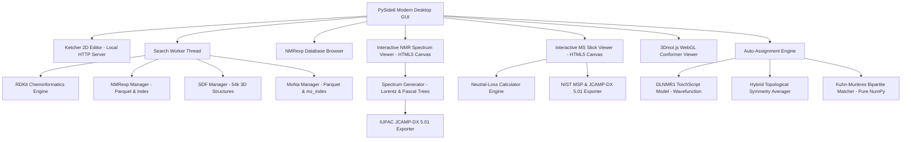

# HGTTD — Hitchhiker's Guide through the Database 🌌🪐

[](https://www.python.org/)
[](https://wiki.qt.io/Qt_for_Python)
[](https://www.rdkit.org/)
[](https://pytorch.org/)
[](https://creativecommons.org/licenses/by-nc-nd/4.0/)
[](https://creativecommons.org/licenses/by/4.0/)
[](https://doi.org/10.1021/acs.joc.4c02914)
[](https://doi.org/10.6084/m9.figshare.30734843)
[](README_de.md)

> *"DON'T PANIC"* — The interactive chemical desktop companion for exploring over **3.37 million experimental NMR spectra**, **54,000 3D molecular geometries**, **1.75 million mass spectra (MoNa)**, and **133,883 infrared spectra (SQuIRL & NIST)**. Featuring physical spectral synthesis, automated peak assignment via deep learning (**est-NMR / DLNMR1**), interactive MS stick viewer with neutral loss calculator, 60 FPS FT-IR transmittance/absorbance viewer, and IUPAC JCAMP-DX / NIST MSP export.

*Deutsche Dokumentation verfügbar in [README_de.md](README_de.md).*

---

## Table of Contents

1. [Overview](#overview)
2. [Key Features](#key-features)
3. [Scientific Sources & Citations](#scientific-sources--citations)
   - [1. NMRexp Database (Nature Scientific Data 2025)](#1-nmrexp-database)
   - [2. est-NMR & DLNMR1 Deep Learning Model (Wavefunction, Inc. / JOC 2025)](#2-est-nmr--dlnmr1-deep-learning-model)
   - [3. nmrshiftdb2 (University of Cologne)](#3-nmrshiftdb2-database)
   - [4. MassBank of North America - MoNa (UC Davis)](#4-massbank-of-north-america-mona)
   - [5. SQuIRL & NIST Infrared Spectra Library](#5-squirl--nist-infrared-spectra-library)
   - [6. Embedded Open-Source Libraries](#6-embedded-open-source-software--libraries)
4. [System Architecture & Technologies](#system-architecture--technologies)
5. [Installation & Quick Start](#installation--quick-start)
6. [User Guide](#user-guide)
   - [Structure Search (Exact, Substructure & Similarity)](#structure-search-exact-substructure--similarity)
   - [Persistent Research Logbook & Bookmarks](#persistent-research-logbook--bookmarks)
   - [NMRexp Database Browser](#nmrexp-database-browser)
   - [NMR Spectrum Viewer, Synthesis & Mirror Plot](#nmr-spectrum-viewer-synthesis--mirror-plot)
   - [Interactive Cross-Highlighting (Peak ↔ 3D Atom)](#interactive-cross-highlighting-peak--3d-atom)
   - [AI-Powered Auto-Assignment](#ai-powered-auto-assignment)
   - [Automated Laboratory Report (HTML/PDF Export)](#automated-laboratory-report-htmlpdf-export)
   - [Mass Spectrum Viewer & Neutral Loss Calculator (MoNa)](#mass-spectrum-viewer--neutral-loss-calculator-mona)
   - [Infrared Spectrum Viewer & Band Annotation (SQuIRL & NIST)](#infrared-spectrum-viewer--band-annotation-squirl--nist)
   - [3D Molecular Conformer Viewer & Force Field Optimization](#3d-molecular-conformer-viewer--force-field-optimization)
7. [Project Structure](#project-structure)
8. [Project License](#project-license)

---

## Overview

**HGTTD** (*Hitchhiker's Guide through the Database*) is an independent, modern desktop application designed for organic chemists, spectroscopists, and structural analysts. The software integrates three premier open spectroscopy reference datasets:

- **NMRexp**: 3,372,987 experimental NMR datasets across **6 nuclei** (¹H, ¹³C, ¹⁹F, ³¹P, ¹¹B, ²⁹Si), extracted from nearly 200,000 peer-reviewed articles (2010–2024).
- **nmrshiftdb2**: Over 54,000 organic molecules with DFT-optimized 3D coordinates and experimental ¹³C chemical shifts.
- **MassBank of North America (MoNa)**: 1,756,800 experimental mass spectra and 271,982 distinct compounds from the UC Davis Oliver Fiehn Lab, comprising high-resolution LC-MS/MS (Agilent QTOF & Orbitrap) and electron ionization GC-MS (EI 70 eV).
- **SQuIRL & NIST (IR)**: 133,883 high-precision DFT vibrational spectra ($\omega$B97X-D/aug-cc-pVTZ) and experimental infrared spectra.

The database search is powered by a **local deep learning inference engine** (**est-NMR / DLNMR1** by Wavefunction, Inc.) for sub-20 ms chemical shift prediction, a **topological symmetry averaging & bipartite Kuhn-Munkres matching** algorithm for automated experimental peak assignment, an **interactive MS stick viewer with real-time neutral loss interpretation**, and an **interactive 60 FPS FT-IR transmittance/absorbance canvas viewer**.

---

## Key Features

- 🌌 **Cosmic & Intuitive User Interface**: Modern dark theme, fully bilingual (**German & English**), with integrated Ketcher 2D molecular editor (guaranteed minimum width $\ge 33.3\%$ of application window).
- 📔 **Persistent Research Logbook & Bookmarks (SQLite)**:
  - Local database storage in `user_logbook.db` — survives application restarts reliably.
  - Dedicated tab `📔 Logbook` (`Alt+5`) with bookmarks (`⭐ Favorites`), full activity history (`🕒 History`), search filters, notes/tags editor, and quick actions (Ketcher, 3D, NMR).
  - One-click bookmark buttons in browse view and on every search result card.
- 🎯 **Multimodal Structure Search (Exact, Substructure & Similarity)**:
  - Query across NMRexp, nmrshiftdb2, MoNa MS, SQuIRL/NIST IR, or all repositories simultaneously.
  - **🔮 Tanimoto Similarity Search**: ECFP4 Morgan fingerprints (radius 2, 2048 bits) with customizable threshold ($\ge 60\%$, $\ge 70\%$, $\ge 80\%$, $\ge 90\%$) and percent badges.
  - Atom- and bond-accurate **cyan highlighting (`#38bdf8`)** for substructure matches.
  - Precompiled indices enabling sub-second substructure queries.
- 📖 **NMRexp Database Browser**:
  - Direct exploration of all 3.37+ million experimental spectra.
  - Filter by nucleus, direct jump navigation, random molecule picker (`🎲 Random`), and direct transfer to Ketcher (`📥 Load into Ketcher`).
  - One-click DOI link opening original peer-reviewed publication.
- 📈 **Interactive 60 FPS Spectrum Synthesizer & Mirror Plot**:
  - Continuous physical **Lorentzian deconvolution/synthesis** in real time (vectorized with NumPy).
  - 1st-order Pascal multiplet splitting trees ($s, d, t, q, quint, sext, dd, dt, dq, m$).
  - Cumulative step-wise integration curve for ¹H NMR.
  - **🪞 Spectrum Comparison & Mirror Plot**: Pin reference spectra (`📌 Pin as Reference`) with mirrored inverse rendering below the baseline for instant isomer/derivative comparison.
  - Interactive HTML5 canvas: smooth zoom (mouse wheel), pan (drag), vertical intensity scaling (Shift+wheel / right-click drag).
  - Stepless line width adjustment (FWHM $0.2 \dots 15.0\text{ Hz}$) and spectrometer frequency ($100 \dots 800\text{ MHz}$).
  - **Standard-compliant IUPAC JCAMP-DX 5.01 Export** (`##XYDATA`, `##PEAK TABLE`).
- 🎯 **Interactive Cross-Highlighting (Peak ↔ 3D & 2D Atom)**:
  - Hovering or clicking peaks in the NMR spectrum viewer highlights the corresponding atoms as golden glowing spheres in the **3D viewer** and in the 2D structure SVG in real time.
- 🤖 **Standalone Auto-Assignment Engine (est-NMR & DLNMR1)**:
  - Local PyTorch CPU inference (< 20 ms) with zero cloud dependency.
  - **Hybrid Fragment Symmetry Ranking**: Rotatable bond decomposition preserving free rotational equivalences while accurately detecting diastereotopicity.
  - **Symmetry Averaging & Kuhn-Munkres Bipartite Matching**: Minimum-cost peak-to-atom assignment in $< 0.1\text{ ms}$.
  - Confidence classification (*High*, *Medium*, *Low*) with $\Delta\delta$ and MAE statistics.
  - Visual signal markers in spectrum viewer and numbered atomic labels in 2D SVG.
- 📑 **Automated Laboratory Report (HTML/PDF Export)**:
  - Generates publication-ready A4 certificates of analysis including numbered 2D structure, physicochemical descriptors, peak assignment tables, and personal research notes from the logbook.
- 🔬 **3D Conformer Viewer (3Dmol.js)**:
  - Interactive WebGL 3D molecular viewer with local **MMFF94 force field geometry optimization** and real-time energy minimization animation.
- ⚡ **Mass Spectrometry Integration (MassBank of North America - MoNa)**:
  - High-speed Parquet data pipeline for MoNa with **1,756,800 spectra** and **271,982 compounds** (EI GC-MS & high-resolution LC-MS/MS QTOF/Orbitrap).
  - Precursor $m/z$ range search ($\pm\text{ppm} / \text{Da}$) via binary $O(\log N)$ index.
  - Interactive 60 FPS **MS Stick Viewer** (`viewer_ms.py`) with tabular peak inspector and **CSV export**.
  - **Neutral Loss Calculator**: Automatic detection and assignment of common neutral losses ($-\text{H}_2\text{O}$, $-\text{CO}$, $-\text{NH}_3$, etc.) on peak click.
  - Mass spectral export in **NIST MSP** and **IUPAC JCAMP-DX 5.01** formats.
- 🔴 **Infrared Spectroscopy Integration (SQuIRL & NIST IR)**:
  - High-performance Parquet database containing **133,883 vibrational spectra** and unique SMILES substructure indices.
  - Interactive 60 FPS **FT-IR Canvas Viewer** (`viewer_ir.py`) with standard reverse wavenumber axis ($4000 \dots 400\text{ cm}^{-1}$).
  - Toggle seamlessly between **📉 Transmittance (%T)** (dips down) and **📈 Absorbance** (peaks up).
  - Dynamic Lorentzian convolution with adjustable **FWHM linewidth slider** ($4 \dots 30\text{ cm}^{-1}$).
  - **Characteristic Functional Group Annotations**: Highlights key vibrational zones ($\text{O-H}$, $\text{N-H}$, $\text{C-H}$, carbonyl $\text{C=O}$, $\text{C}\equiv\text{C}$, $\text{C}\equiv\text{N}$, fingerprint region).
  - Standard-compliant **IUPAC JCAMP-DX 5.01 Export** (`##DATA TYPE= INFRARED SPECTRUM`).

---

## Scientific Sources & Citations

To maintain scientific integrity and respect intellectual property rights, all integrated data sources, models, and third-party software components are documented below:

### 1. NMRexp Database

Experimental NMR spectra integrated in HGTTD originate from the **NMRexp** database (version 10to24):

- **Scientific Publication:**
  > Jun-Jie Wang, Yongqi Jin, Chen-Yu Zhi, Yu-Jie Liu, Xu-Hao Huang, Fanjie Xu, Xiaohong Ji, Xi Fang, Haoyi Tao, Weinan E, Linfeng Zhang, Guolin Ke, and Rong Zhu.  
  > **"NMRexp: A database of 3.3 million experimental NMR spectra"**  
  > *Scientific Data* (Nature Publishing Group), **2025**, Volume 12, Article number: 1954.  
  > **DOI:** [10.1038/s41597-025-06245-5](https://doi.org/10.1038/s41597-025-06245-5)

- **Participating Institutions:**
  - Peking University, Beijing, China
  - AI for Science Institute (AISI), Beijing, China
  - DP Technology, Beijing, China
  - Center for Machine Learning Research, Peking University

- **License & Terms of Use:**
  - **Creative Commons Attribution-NonCommercial-NoDerivatives 4.0 International (CC BY-NC-ND 4.0)**
  - License URL: [http://creativecommons.org/licenses/by-nc-nd/4.0/](http://creativecommons.org/licenses/by-nc-nd/4.0/)
  - **Notice:** NMRexp is used within HGTTD strictly for academic, scientific, and non-commercial purposes. Any redistribution or publication of research findings obtained with HGTTD must cite the primary paper referenced above.

---

### 2. est-NMR & DLNMR1 Deep Learning Model

Automated peak assignment is powered by the neural network **DLNMR1** from the **est-NMR** project:

- **Scientific Publication:**
  > Thomas Hehre, Philip E. Klunzinger, Bernard J. Deppmeier, William Sean Ohlinger, and Warren J. Hehre.  
  > **"Practical Machine Learning Strategies 4: Using Neural Networks to Replicate Proton and 13C NMR Chemical Shifts Obtained from $\omega$B97X-D/6-31G* Density Functional Calculations"**  
  > *Journal of Organic Chemistry*, **2025**, 90, 11478–11485.  
  > **DOI:** [10.1021/acs.joc.4c02914](https://doi.org/10.1021/acs.joc.4c02914)

- **Authors & Copyright:**
  - **© Wavefunction, Inc.** (18401 Von Karman Ave., Suite 370, Irvine, CA 92606, USA).
  - Software & Repository: **est-NMR** (`DLNMR1.pt` TorchScript model).
  - Website: [https://www.wavefun.com](https://www.wavefun.com)

- **Description:**
  The DLNMR1 model predicts DFT-quality ($\omega$B97X-D/6-31G*) chemical shifts for protons (¹H) and carbons (¹³C) within milliseconds on commodity desktop CPUs.

- **Attribution & Acknowledgments:**
  We gratefully acknowledge Thomas Hehre et al. and Wavefunction, Inc. for making this model architecture openly accessible for scientific and academic research.

---

### 3. nmrshiftdb2 Database

3D-optimized molecular conformations and experimental ¹³C NMR shifts originate from **nmrshiftdb2**:

- **Scientific Publication:**
  > Christoph Steinbeck, Stefan Krause, Stefan Kuhn.  
  > **"NMRShiftDB: a freely available web database for NMR data"**  
  > *Journal of Chemical Information and Computer Sciences*, **2003**, 43(5), 1733–1739.  
  > **DOI:** [10.1021/ci0341527](https://doi.org/10.1021/ci0341527)

- **Project & Maintainers:**
  - Stefan Kuhn, Tobias Helmus et al., University of Cologne / Chemnitz University of Technology.
  - Website: [https://nmrshiftdb.nmr.uni-koeln.de/](https://nmrshiftdb.nmr.uni-koeln.de/)

- **License:**
  - **Creative Commons Attribution-ShareAlike 4.0 International (CC BY-SA 4.0)** / Open Data.

---

### 4. MassBank of North America (MoNa)

Mass spectrometry datasets (LC-MS/MS & GC-MS) are provided by **MoNa**:

- **Project & Organization:**
  - **MassBank of North America (MoNA)**
  - UC Davis Genome Center, Oliver Fiehn Lab (University of California, Davis, CA, USA)
  - Website: [https://mona.fiehnlab.ucdavis.edu/](https://mona.fiehnlab.ucdavis.edu/)

- **Scientific Publication (MassBank Reference):**
  > Hisayuki Horai, Masanori Arita, Shigehiko Kanaya, Yoshihiro Nihei, Tasuku Ikeda, Kazuhiro Suwa, Yuya Ojima, Kenichi Tanaka, Satoshi Tanaka, Ken Aoshima, Yoshiya Oda, Yuji Kakazu, Miyako Kusano, Taketo Tohge, Fumio Matsuda, Yuji Sawada, Masami Yokota Hirai, Hiroki Nakanishi, Kazutaka Ikeda, Naoshige Akimoto, Takashi Maoka, Hiroki Takahashi, Takaaki Ara, Nozomu Sakurai, Hideyuki Suzuki, Daisuke Shibata, Steffen Neumann, Tadao Iida, Ken Tanaka, Kimito Funatsu, Fuminori Matsuura, Tomoyoshi Soga, Ryo Taguchi, and Kazuki Saito.  
  > **"MassBank: a public repository for sharing mass spectral data for life sciences"**  
  > *Journal of Mass Spectrometry*, **2010**, 45(7), 703–714.  
  > **DOI:** [10.1002/jms.1777](https://doi.org/10.1002/jms.1777)

- **License:**
  - **Creative Commons Attribution 4.0 International (CC BY 4.0)** / Open Data.
  - License URL: [https://creativecommons.org/licenses/by/4.0/](https://creativecommons.org/licenses/by/4.0/)

---

### 5. SQuIRL & NIST Infrared Spectra Library

Infrared spectroscopic datasets integrated in HGTTD combine computational DFT vibrational frequencies with experimental reference data:

- **SQuIRL Dataset (Spectral Quantum Chemistry and Infrared Resonance Library):**
  > **DOI:** [10.6084/m9.figshare.30734843](https://doi.org/10.6084/m9.figshare.30734843)  
  > Contains high-accuracy harmonic vibrational frequencies, infrared intensities, and electrostatics for **133,883 organic molecules** computed at the $\omega\text{B97X-D}/\text{aug-cc-pVTZ}$ level of theory.
  - **License:** [Creative Commons Attribution 4.0 International (CC BY 4.0)](https://creativecommons.org/licenses/by/4.0/)

- **NIST Chemistry WebBook (SRD 69):**
  - **Provider:** National Institute of Standards and Technology (NIST), Gaithersburg, MD, USA.
  - **Content:** Experimental gas-phase and condensed-phase infrared spectra.
  - **Website:** [https://webbook.nist.gov/chemistry/](https://webbook.nist.gov/chemistry/)

---

### 6. Embedded Open-Source Software & Libraries

| Component | Role | License | Website / Repository |
| :--- | :--- | :--- | :--- |
| **RDKit** | Cheminformatics, descriptors, fingerprints | BSD 3-Clause | [rdkit.org](https://www.rdkit.org/) |
| **PySide6 / Qt6** | Native GUI framework (The Qt Company) | LGPLv3 | [qt.io](https://www.qt.io/) |
| **PyTorch (CPU)** | Deep learning tensor engine | Modified BSD | [pytorch.org](https://pytorch.org/) |
| **Ketcher** | Web-based chemical structure editor (EPAM) | Apache 2.0 | [lifescience.opensource.epam.com](https://lifescience.opensource.epam.com/ketcher/) |
| **3Dmol.js** | WebGL 3D molecular viewer (*Bioinformatics* 2015) | BSD 3-Clause | [3dmol.csb.pitt.edu](https://3dmol.csb.pitt.edu/) |
| **PyArrow** | Apache Arrow & Parquet storage engine | Apache 2.0 | [arrow.apache.org](https://arrow.apache.org/) |
| **NumPy** | Vectorized computation & Lorentzian synthesis | BSD 3-Clause | [numpy.org](https://numpy.org/) |

---

## System Architecture & Technologies



---

## Installation & Quick Start

### Prerequisites
- **Operating System:** Windows 10 / 11 (64-bit) or Linux/macOS with Python 3.10+.
- **Preconfigured Environment:** The repository is configured to work with either the bundled `python-portable` distribution on Windows or a standard Python virtual environment.

### Standard Installation (Any Platform)

```bash
git clone https://github.com/steto123/HGTTD.git
cd HGTTD

# Create and activate virtual environment
python -m venv venv
# On Windows:
venv\Scripts\activate
# On Linux/macOS:
source venv/bin/activate

# Install dependencies
pip install -r requirements.txt

# Run application
python app.py
```

### Windows Portable Quick Start

On Windows with the portable environment set up:
```cmd
run.bat
```
or directly:
```cmd
.\python-portable\python.exe app.py
```

On first launch, the local Ketcher micro-server initializes, database indices are mapped into memory, and the main application window appears.

---

## User Guide

### Structure Search (Exact, Substructure & Similarity)
1. **Draw:** Draw your target molecule or core scaffold in the embedded Ketcher editor (left half of the screen).
2. **Select Search Criteria:**
   - **Data Source:** `All Sources`, `Both NMR Databases`, `NMRexp (3.37M)`, `nmrshiftdb2 (54k)`, or `MoNa MassBank (MS)`.
   - **Nucleus Filter:** `All Nuclei`, `¹H`, `¹³C`, `¹⁹F`, `³¹P`, `¹¹B`, or `²⁹Si`.
   - **Search Mode:**
     - `🎯 Exact`: Structurally identical isomers.
     - `🧬 Substructure`: Scaffold matching with cyan bond/atom highlighting (`#38bdf8`).
     - `🔮 Similarity`: Tanimoto similarity search via ECFP4 Morgan fingerprints.
   - **Similarity Threshold:** Choose `>= 60%`, `>= 70%`, `>= 80%`, or `>= 90%`.
   - **Hit Limit:** `50`, `100`, `250`, `500`, or `All`.
3. **Run Search:** Click `🔍 Search`.
   - Hits in similarity searches automatically show a purple relevance badge (e.g. `🔮 88.5%`).
   - Any running search can be canceled immediately via the red `🛑 Stop` button.

### Persistent Research Logbook & Bookmarks
1. **Bookmark Molecules:**
   - Click **`⭐ Bookmark`** in the database browser or on any search result card.
   - The molecule and metadata are immediately committed to the local SQLite database (`user_logbook.db`).
2. **Access Logbook:**
   - Switch to tab **`📔 Logbook`** (`Alt+5`) in the right panel.
   - Filter between **`⭐ Favorites`** (your pinned entries) and **`🕒 History`** (full query and inspection log).
   - Write compound-specific lab notes and add tags/labels.
   - Transfer saved entries to Ketcher (`✏️ Ketcher`), open in 3D (`🔬 3D`), or inspect spectra (`📈 NMR`).
   - Data persists across application sessions and computer restarts.

### NMRexp Database Browser
- Click **`🌌 NMRexp Browse`** in the navigation header to explore all 3,372,987 spectra.
- Filter by nucleus (e.g., exclusively ³¹P or ¹¹B spectra).
- Navigate with `⏮`, `◀`, `▶`, `⏭`, or `🎲 Random`.
- Click **`📥 Load into Ketcher`** to send the structure to the editor and build derivatives.
- Click the **DOI button** to open the original peer-reviewed publication directly in your browser.

### NMR Spectrum Viewer, Synthesis & Mirror Plot
1. Click **`📈 Spectrum`** on any hit card or browse page.
2. Select the nucleus tab for multinuclear entries (e.g., `1H`, `13C`, `31P`).
3. **Interactive Navigation:**
   - **Mouse Wheel:** Zoom horizontally, centered at the cursor position.
   - **Left-Click Drag:** Pan spectrum horizontally.
   - **Shift + Mouse Wheel** or **Right-Click Drag:** Scale vertical signal intensity smoothly.
   - **Double Click:** Reset view to full spectral window.
   - **Hover Peaks:** Reticle and tooltip displaying chemical shift ($\delta$), multiplicity, coupling constants ($J$), and integral.
4. **Control Bar:**
   - **FWHM Slider:** Adjust Lorentzian linewidth from $0.2\text{ to }15.0\text{ Hz}$.
   - **MHz Selector:** Simulate field-dependent splitting trees from $100\text{ to }800\text{ MHz}$.
   - **Integrals Checkbox:** Toggle amber cumulative step curve (¹H).
   - **🪞 Mirror Plot:** Click **`📌 Pin as Reference`** to freeze a spectrum and display it inverted below the baseline for instant comparison with other isomers or derivatives.
5. **JCAMP-DX Export:** Click **`💾 JCAMP-DX`** to save the synthesized spectrum as standard `.jdx` file for opening in MestReNova, TopSpin, or Spekwin32.

### AI-Powered Auto-Assignment
For ¹H and ¹³C NMR spectra, HGTTD automatically resolves experimental peaks to specific atom positions:
- **DLNMR1 Inference:** The deep learning model predicts $\omega$B97X-D shifts in $< 20\text{ ms}$.
- **Symmetry Grouping:** Chemically equivalent atoms (e.g., rotating methyl groups, symmetric ring carbons) are consolidated under canonical labels (e.g., `C1`, `C2,6`, `2H(C2,6)`).
- **Kuhn-Munkres Matching:** Experimental signals are mapped onto predicted symmetry groups with minimal overall deviation.
- **Assignment Table:** Columns `[Assignment (est-NMR)]`, `[δcalc]`, and `[Δδ]` show assignments and errors color-coded. A summary badge indicates assignment completeness and MAE (Mean Absolute Error).
- **Spectrum Viewer Overlay:**
   - Toggle **`[🏷️ Auto-Assignment]`** to show atom tags floating over spectral peaks.
   - Toggle **`[📐 est-NMR Positions]`** to draw vertical theoretical drop-lines for visual comparison.
- **2D Structure Form:** Assigned atoms are highlighted with their matching labels directly on the structure formula.

### Automated Laboratory Report (HTML/PDF Export)
- Generate publication-quality A4 certificates of analysis at the click of a button.
- Includes numbered 2D structural diagram, IUPAC name/formula/molecular weight, comprehensive peak tables with assignments, and your personal lab notes from the logbook.
- Export as clean HTML or vector-rendered PDF document.

### Mass Spectrum Viewer & Neutral Loss Calculator (MoNa)
With the integration of **MassBank of North America (MoNa)**:
1. **Search:** Select **`MoNa MassBank (MS)`** or **`All Sources`** and run exact/substructure queries across **1,756,800 spectra**.
2. **MoNa Hit Cards:** Purple cards displaying ionization mode (ESI positive/negative, EI 70 eV), instrument type (QTOF, Orbitrap), precursor $m/z$, adduct type ($[M+H]^+$, $[M+Na]^+$, $[M-H]^-$), collision energy, and top 8 fragment peaks.
3. **Interactive MS Stick Viewer (Tab 3: `⚡ MS Spectrum`):**
   - $m/z$ axis scaled from left to right, relative intensities from $0\text{ to }100\%$.
   - **Color Coding:**
     - 🌟 **Amber Gold:** Base peak ($100\%$).
     - 🟢 **Emerald Green:** Precursor/adduct ion.
     - 🔷 **Neon Cyan:** Fragment ions.
   - **Noise Filter (Cutoff Slider):** Filter out background noise ($0 \dots 25\%$) in real time.
4. **Interactive Neutral Loss Calculator:**
   - Check **`🔍 Neutral-Loss Measurement`**.
   - Click any two peaks in sequence.
   - HGTTD automatically calculates $\Delta m/z$ and checks against its built-in database of common neutral losses:
     - $\Delta m/z \approx 18.01\text{ Da} \rightarrow -\text{H}_2\text{O}$ (dehydration)
     - $\Delta m/z \approx 27.99\text{ Da} \rightarrow -\text{CO}$ (carbon monoxide)
     - $\Delta m/z \approx 17.03\text{ Da} \rightarrow -\text{NH}_3$ (ammonia)
     - $\Delta m/z \approx 43.99\text{ Da} \rightarrow -\text{CO}_2$ (decarboxylation)
     - $\Delta m/z \approx 15.02\text{ Da} \rightarrow -\text{CH}_3$ (methyl radical)
     - $\Delta m/z \approx 60.02\text{ Da} \rightarrow -\text{CH}_3\text{COOH}$ (acetic acid), etc.
5. **MS Export:**
   - **`💾 NIST MSP`**: Exports full mass spectrum with metadata into standardized NIST MSP format.
   - **`💾 JCAMP-DX`**: Exports spectrum as IUPAC JCAMP-DX 5.01 (`##DATA TYPE= MASS SPECTRUM`).

### Infrared Spectrum Viewer & Band Annotation (SQuIRL & NIST)
With the integration of the **SQuIRL & NIST Infrared Library**:
1. **Search:** Select **`SQuIRL & NIST (134k IR)`** or **`All Sources`** and run exact/substructure queries across **133,883 IR spectra**.
2. **IR Hit Cards:** Crimson cards displaying theory level ($\omega\text{B97X-D}/\text{aug-cc-pVTZ}$), physical state (gas phase), number of fundamental vibrational modes, and the top 8 absorption bands in $\text{cm}^{-1}$ and $\text{km/mol}$.
3. **Interactive 60 FPS Canvas Viewer (Tab 4: `🔴 IR Spectrum`):**
   - **Standard IR Convention:** $x$-axis scaled from high wavenumbers ($4000\text{ cm}^{-1}$) down to $400\text{ cm}^{-1}$.
   - **Mode Switcher:** Toggle between **📉 Transmittance (%T)** ($0 \dots 100\%$, dips pointing downward) and **📈 Absorbance** (peaks pointing upward).
   - **Dynamic Lorentzian Deconvolution:** Continuous synthesis of realistic IR band envelopes with adjustable linewidth slider (**FWHM** $4 \dots 30\text{ cm}^{-1}$).
   - **Characteristic Functional Groups Overlay:** Automatically color-codes diagnostic spectroscopic regions ($\text{O-H}$, $\text{N-H}$, $\text{C-H}$, $\text{C}\equiv\text{C}$, $\text{C}\equiv\text{N}$, $\text{C=O}$ carbonyl, $\text{C=C}$, $\text{C-O}$, fingerprint).
   - **Zoom & Pan:** Smooth mouse-wheel zoom centered on cursor, horizontal left-click drag, and instant view reset.
4. **IUPAC JCAMP-DX Export:**
   - Click **`💾 JCAMP-DX`** to export the spectrum in standard IUPAC JCAMP-DX 5.01 format (`##DATA TYPE= INFRARED SPECTRUM`, `##XUNITS= 1/CM`, `##YUNITS= TRANSMITTANCE`).

### 3D Molecular Conformer Viewer & Force Field Optimization
- Switch to tab **`🔬 3D View`**.
- Displays native DFT 3D coordinates (nmrshiftdb2) or generates 3D conformers via RDKit from SMILES.
- Click **`⚡ MMFF94 Optimize`** to run interactive force field energy minimization with real-time visual trajectory updates.

---

## Project Structure

```
HGTTD/
├── app.py                         # Application entry point & Qt initialization
├── run.bat                        # Windows launch batch script
├── main_window.py                 # Main window, navigation tabs, search & result cards
├── search_worker.py               # Asynchronous worker thread for multi-source search
├── nmrexp_manager.py              # High-performance Parquet engine for NMRexp
├── database_manager.py            # SQLite/SDF manager for nmrshiftdb2
├── mona_manager.py                # MoNa MassBank Parquet pipeline & mz_index
├── ir_manager.py                  # SQuIRL & NIST Infrared database manager & synthesis
├── spectrum_generator.py          # Lorentzian synthesis, Pascal trees & JCAMP-DX exporter
├── viewer_spectrum.py             # Interactive 60 FPS HTML5 canvas NMR viewer & mirror plot
├── viewer_ms.py                   # Interactive 60 FPS HTML5 canvas MS stick viewer & neutral loss calculator
├── viewer_ir.py                   # Interactive 60 FPS HTML5 canvas FT-IR viewer & band annotator
├── download_and_compile_mona.py   # Downloader & compiler for MoNa MSP data
├── download_and_compile_ir.py     # Downloader & compiler for SQuIRL HDF5 / Figshare data
├── logbook_manager.py             # Persistent SQLite manager for notes, tags, bookmarks & history
├── logbook_widget.py              # Qt tab widget for research logbook
├── report_generator.py            # Publication-grade A4 lab report generator (HTML/PDF)
├── auto_assignment_engine.py      # DLNMR1 inference, symmetry averaging, Kuhn-Munkres solver
├── viewer_3d.py                   # 3Dmol.js WebGL viewer & MMFF94 force field optimizer
├── ketcher_server.py              # Local HTTP micro-server for embedded Ketcher
├── config_manager.py              # Persistent configuration manager
├── i18n.py                        # Bilingual localization system (DE / EN)
├── models/
│   └── DLNMR1.pt                  # TorchScript deep learning model (Wavefunction, Inc.)
├── mona/                          # MassBank of North America database & indices
│   ├── mona_spectra.parquet       # 1,756,800 mass spectra (GC-MS & LC-MS/MS QTOF)
│   ├── unique_smiles_index.parquet# Substructure prefilter index (270k SMILES)
│   └── mz_index.npz               # Binary precursor m/z index
├── ir/                            # SQuIRL & NIST Infrared database & indices
│   ├── ir_spectra.parquet         # 133,883 DFT infrared spectra (ωB97X-D)
│   ├── unique_smiles_index.parquet# Substructure prefilter index (134k SMILES)
│   └── downloads/                 # Downloaded SQuIRL HDF5 archive
├── nmr_exp/
│   ├── NMRexp_10to24_1_1004.parquet # 3.37M experimental spectra
│   ├── nuclei_index.npz           # Precompiled nucleus index
│   └── unique_smiles_index.parquet# Substructure prefilter index
├── ketcher/                       # Embedded Ketcher editor bundle
├── requirements.txt               # Python package dependencies
├── config.example.json            # Template configuration file
├── README.md                      # English documentation (this file)
├── README_de.md                   # German documentation
└── LICENSE                        # MIT License
```

---

## Project License

The source code of HGTTD is licensed under the **MIT License** for academic, educational, and scientific purposes.

The included databases and models remain under their respective copyright and licensing terms:
- **NMRexp Dataset:** © 2025 The Authors ([CC BY-NC-ND 4.0](https://creativecommons.org/licenses/by-nc-nd/4.0/)).
- **est-NMR / DLNMR1 Model:** © 2025 Wavefunction, Inc. ([Wavefunction Notice / JOC 2025](https://doi.org/10.1021/acs.joc.4c02914)).
- **nmrshiftdb2:** © 2003–2026 nmrshiftdb2 Team ([CC BY-SA 4.0](https://creativecommons.org/licenses/by-sa/4.0/)).
- **MassBank of North America (MoNa):** © UC Davis Genome Center / Fiehn Lab ([CC BY 4.0](https://creativecommons.org/licenses/by/4.0/)).
