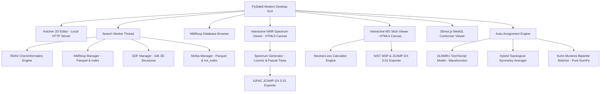

# HGTTD — Hitchhiker's Guide through the Database 🌌🪐

[](https://www.python.org/)
[](https://wiki.qt.io/Qt_for_Python)
[](https://www.rdkit.org/)
[](https://pytorch.org/)
[](https://creativecommons.org/licenses/by-nc-nd/4.0/)
[](https://creativecommons.org/licenses/by/4.0/)
[](https://doi.org/10.1021/acs.joc.4c02914)
[](https://doi.org/10.6084/m9.figshare.30734843)

> *"DON'T PANIC"* — Der interaktive chemische Desktop-Begleiter zur Erkundung von über **3,37 Millionen experimentellen NMR-Spektren**, **54.000 3D-Molekülgeometrien**, **1,75 Millionen Massenspektren (MoNa)** und **133.883 Infrarotspektren (SQuIRL & NIST)**. Mit physikalischer Spektren-Synthese, automatischer Peak-Zuordnung mittels Deep Learning (**est-NMR / DLNMR1**), interaktivem MS-Stick-Viewer mit Neutral-Loss-Rechner, 60-FPS FT-IR-Transmittanz/Absorptions-Viewer und IUPAC JCAMP-DX / NIST MSP Export.

---

## Inhaltsverzeichnis

1. [Überblick](#überblick)
2. [Hauptfunktionen](#hauptfunktionen)
3. [Wissenschaftliche Quellen & Lizenzbedingungen (Zitierungen)](#wissenschaftliche-quellen--lizenzbedingungen)
   - [1. NMRexp Datenbank (Nature Scientific Data 2025)](#1-nmrexp-datenbank)
   - [2. est-NMR & DLNMR1 Modell (Wavefunction, Inc. / JOC 2025)](#2-est-nmr--dlnmr1-deep-learning-modell)
   - [3. nmrshiftdb2 (Universität zu Köln)](#3-nmrshiftdb2-datenbank)
   - [4. MassBank of North America - MoNa (UC Davis)](#4-massbank-of-north-america-mona)
   - [5. SQuIRL & NIST Infrarot-Spektrenbibliothek](#5-squirl--nist-infrarot-spektrenbibliothek)
   - [6. Eingebundene Open-Source Komponenten](#6-eingebundene-open-source-software--bibliotheken)
4. [Systemarchitektur & Technologien](#systemarchitektur--technologien)
5. [Installation & Schnellstart](#installation--schnellstart)
6. [Bedienungsanleitung](#bedienungsanleitung)
   - [Struktursuche (Exakt, Substruktur & Ähnlichkeit)](#struktursuche-exakt-substruktur--ähnlichkeit)
   - [Persistentes Forschungs-Logbuch & Lesezeichen](#persistentes-forschungs-logbuch--lesezeichen)
   - [NMRexp-Browser](#nmrexp-browser)
   - [NMR-Spektren-Viewer, Synthese & Mirror-Plot](#nmr-spektren-viewer-synthese--mirror-plot)
   - [Interaktives Cross-Highlighting (Peak ↔ 3D-Atom)](#interaktives-cross-highlighting-peak--3d-atom)
   - [KI-gestützte Auto-Zuordnung (Auto-Assignment)](#ki-gestützte-auto-zuordnung-auto-assignment)
   - [Automatisierter Laborbericht (HTML/PDF-Export)](#automatisierter-laborbericht-htmlpdf-export)
   - [Massenspektren-Viewer & Neutral-Loss-Rechner (MoNa)](#massenspektren-viewer--neutral-loss-rechner-mona)
   - [Infrarotspektren-Viewer & Banden-Annotation (SQuIRL & NIST)](#infrarotspektren-viewer--banden-annotation-squirl--nist)
   - [3D-Molekülbetrachter & Kraftfeld-Optimierung](#3d-molekülbetrachter--kraftfeld-optimierung)
7. [Projektstruktur](#projektstruktur)
8. [Lizenz des Projekts](#lizenz-des-projekts)

---

## Überblick

**HGTTD** (*Hitchhiker's Guide through the database*) ist eine moderne, eigenständige Desktop-Anwendung für Chemiker, Spektroskopiker und Strukturaufklärer. Die Software vereint drei mächtige freie Referenzquellen der Spektroskopie:

- **NMRexp**: 3.372.987 experimentelle NMR-Datensätze über **6 Kerne** (¹H, ¹³C, ¹⁹F, ³¹P, ¹¹B, ²⁹Si), extrahiert aus knapp 200.000 wissenschaftlichen Publikationen (2010–2024).
- **nmrshiftdb2**: Über 54.000 organische Moleküle mit DFT-optimierten 3D-Koordinaten und experimentellen ¹³C-Verschiebungen.
- **MassBank of North America (MoNa)**: 1.756.800 experimentelle Massenspektren und 271.982 Verbindungen der UC Davis (Oliver Fiehn Lab), unterteilt in hochauflösende LC-MS/MS (Agilent QTOF & Orbitrap) und GC-MS (Elektronenstoß-Ionisation EI 70 eV).
- **SQuIRL & NIST (IR)**: 133.883 hochpräzise DFT-Schwingungsspektren ($\omega$B97X-D/aug-cc-pVTZ) und experimentelle Infrarotspektren.

Ergänzt wird die Datenbanksuche durch eine **lokale Deep-Learning-Inferenz-Engine** (**est-NMR / DLNMR1** von Wavefunction, Inc.) zur ultraschnellen chemischen Verschiebungsberechnung, einem Algorithmus zum **Symmetrie-Averaging und bipartiten Kuhn-Munkres-Matching** für die automatische Peak-Zuordnung, einem **interaktiven MS-Stick-Viewer mit Neutral-Loss-Rechner** sowie einem **interaktiven 60-FPS FT-IR-Transmittanz/Extinktions-Viewer**.

---

## Hauptfunktionen

- 🌌 **Kosmische & Intuitive Benutzeroberfläche**: Modernes Dark-Theme, zweisprachig (**Deutsch & Englisch**), mit Ketcher 2D-Moleküleditor (garantierte Mindestbreite >= 33,3 % der gesamten Fensterbreite).
- 📔 **Persistentes Forschungs-Logbuch & Lesezeichen (SQLite)**:
  - Lokale Speicherung in `user_logbook.db` - Daten überdauern das Schließen und Neustarten der Anwendung zuverlässig.
  - Tab `📔 Logbuch` (Shortcut `Alt+5`) mit Lesezeichen (`⭐ Favoriten`), vollständiger Aktivitätshistorie (`🕒 Verlauf`), Suchfilter, Notizen- und Tag-Editor sowie Direktaufrufen (Ketcher, 3D, NMR).
  - Ein-Klick-Lesezeichen-Schaltflächen in der Durchblättern-Ansicht und auf jeder Suchergebniskarte.
- 🎯 **Multimodale Struktursuche (Exakt, Substruktur & Ähnlichkeit)**:
  - Suche über NMRexp, nmrshiftdb2, MoNa MS, SQuIRL/NIST IR oder alle Quellen parallel.
  - **🔮 Tanimoto-Ähnlichkeitssuche**: ECFP4-Morgan-Fingerprints (Radius 2, 2048 Bit) mit einstellbarem Schwellenwert (>= 60 %, >= 70 %, >= 80 %, >= 90 %) und Prozent-Score-Badges.
  - Atom- und bindungsgenaues **Cyan-Highlighting (`#38bdf8`)** bei Substruktursuchen.
  - Vorkompilierte Indexe für Substruktursuchen in Millisekunden.
- 📖 **NMRexp Datenbank-Browser**:
  - Direktes Blättern durch mehr als 3,37 Millionen Spektren.
  - Filter nach Kern, Direktnavigation, Zufallsauswahl (`🎲 Zufall`) und Transfer nach Ketcher (`📥 In Ketcher laden`).
  - Direkte Verknüpfung zur Originalpublikation per DOI-Link.
- 📈 **Interaktiver 60-FPS Spektren-Synthesizer & Mirror-Plot**:
  - Kontinuierliche physikalische **Lorentz-Faltung** in Echtzeit (NumPy-vektorisiert).
  - Pascal-Aufspaltungsbäume 1. Ordnung für Multipletts ($s, d, t, q, quint, sext, dd, dt, dq, m$).
  - Stufenförmige kumulative Integralkurve für ¹H-NMR.
  - **🪞 Spektren-Vergleich & Mirror-Plot**: Fixieren von Referenzspektren (`📌 Als Referenz merken`) und gespiegelte Invert-Darstellung unter der Basislinie zum direkten Isomeren-/Derivate-Vergleich.
  - Interaktiver HTML5-Canvas: Zoom (Mausrad), Pan (Drag), vertikale Intensitätsskalierung (Shift+Rad / Rechtsklick-Ziehen).
  - Stufenlose Linienbreite (FWHM $0.2 \dots 15.0\text{ Hz}$) und Spektrometerfrequenz ($100 \dots 800\text{ MHz}$).
  - **Standardkonformer IUPAC JCAMP-DX 5.01 Export** (`##XYDATA`, `##PEAK TABLE`).
- 🎯 **Interaktives Cross-Highlighting (Peak ↔ 3D- & 2D-Atom)**:
  - Beim Überfahren (Hover) oder Anklicken von Signalen im NMR-Spektren-Viewer werden die zugeordneten Atome im **3D-Molekülbetrachter** in Echtzeit als goldene Sphären hervorgehoben.
- 🤖 **Standalone Auto-Assignment Engine (est-NMR & DLNMR1)**:
  - Lokale PyTorch CPU-Inferenz (< 20 ms) ohne Cloud-Abhängigkeit.
  - **Hybrid-Fragment Symmetrie-Ranking**: Zerlegung rotierbarer Bindungen zur Erhaltung freier Rotationsäquivalenzen bei gleichzeitiger Detektion echter Diastereotopie.
  - **Symmetrie-Averaging & Kuhn-Munkres Bipartites Matching**: Minimal-Kosten-Zuordnung in $< 0,1\text{ ms}$.
  - Konfidenz-Klassifizierung (*Sehr gut*, *Mäßig*, *Gering*) mit $\Delta\delta$- und MAE-Statistik.
  - Visuelle Signalmarker im Spektren-Viewer und farbige Atomzuordnungen im 2D-SVG.
- 📑 **Automatisierter Laborbericht (HTML/PDF-Export)**:
  - Erzeugung druckfertiger A4-Analysenzertifikate mit 2D-Struktur (nummeriert), Kenndaten, Peakzuordnungstabellen und persönlichen Forschungsnotizen aus dem Logbuch.
- 🔬 **3D-Molekülbetrachter (3Dmol.js)**:
  - Dreidimensionaler interaktiver WebGL-Viewer mit lokaler **MMFF94-Kraftfeld-Konformationsoptimierung** und Echtzeit-Minimierungs-Animation.
- ⚡ **Massenspektrometrie-Integration (MassBank of North America - MoNa)**:
  - High-Speed Parquet-Pipeline für MoNa mit **1.756.800 Spektren** und **271.982 Verbindungen** (GC-MS EI & hochauflösende LC-MS/MS QTOF/Orbitrap).
  - Precursor $m/z$-Intervallsuche ($\pm \text{ppm} / \text{Da}$) via binärem $O(\log N)$ Index.
  - Interaktiver 60-FPS **MS-Stick-Spektren-Viewer** (`viewer_ms.py`) mit tabellarischer Peak-Übersicht und **CSV-Export**.
  - **Neutral-Loss Rechner**: Automatische Identifizierung von Neutralabspaltungen ($-\text{H}_2\text{O}$, $-\text{CO}$, $-\text{NH}_3$, etc.) per Peak-Klick.
  - Export von Massenspektren im **NIST MSP**- und **IUPAC JCAMP-DX 5.01**-Format.
- 🔴 **Infrarotspektroskopie-Integration (SQuIRL & NIST IR)**:
  - Hochleistungs-Parquet-Datenbank mit **133.883 Schwingungsspektren** und Substruktur-Index.
  - Interaktiver 60-FPS **FT-IR Canvas-Viewer** (`viewer_ir.py`) mit standardmäßiger Wellenzahl-Achse ($4000 \dots 400\text{ cm}^{-1}$).
  - Umschaltung zwischen **📉 Transmittanz (%T)** und **📈 Extinktion (Absorbance)**.
  - Kontinuierliche Lorentz-Faltung mit einstellbarer **Linienbreite (FWHM)** ($4 \dots 30\text{ cm}^{-1}$).
  - **Banden-Annotation für funktionelle Gruppen**: Kennzeichnung von $\text{O-H}$, $\text{N-H}$, $\text{C-H}$, $\text{C=O}$ Carbonyl, $\text{C}\equiv\text{C}$, Fingerprint-Bereich etc.
  - Standardkonformer **IUPAC JCAMP-DX 5.01 Export** (`##DATA TYPE= INFRARED SPECTRUM`).

---

## Wissenschaftliche Quellen & Lizenzbedingungen

Zur Einhaltung der wissenschaftlichen Redlichkeit sowie der jeweiligen Urheber- und Lizenzrechte werden nachfolgend alle Datenquellen, Modelle und Drittsoftware-Komponenten detailliert aufgeführt:

### 1. NMRexp Datenbank

Die in HGTTD integrierten experimentellen Spektren stammen aus dem **NMRexp**-Datensatz (Version 10to24):

- **Wissenschaftliche Publikation:**
  > Jun-Jie Wang, Yongqi Jin, Chen-Yu Zhi, Yu-Jie Liu, Xu-Hao Huang, Fanjie Xu, Xiaohong Ji, Xi Fang, Haoyi Tao, Weinan E, Linfeng Zhang, Guolin Ke, and Rong Zhu.  
  > **"NMRexp: A database of 3.3 million experimental NMR spectra"**  
  > *Scientific Data* (Nature Publishing Group), **2025**, Volume 12, Article number: 1954.  
  > **DOI:** [10.1038/s41597-025-06245-5](https://doi.org/10.1038/s41597-025-06245-5)

- **Beteiligte Institutionen:**
  - Peking University, Beijing, China
  - AI for Science Institute (AISI), Beijing, China
  - DP Technology, Beijing, China
  - Center for Machine Learning Research, Peking University

- **Lizenz & Nutzungsbedingungen:**
  - **Creative Commons Attribution-NonCommercial-NoDerivatives 4.0 International (CC BY-NC-ND 4.0)**
  - Link zur Lizenz: [http://creativecommons.org/licenses/by-nc-nd/4.0/](http://creativecommons.org/licenses/by-nc-nd/4.0/)
  - **Lizenzhinweis:** Die NMRexp-Datenbank wird in HGTTD ausschließlich für wissenschaftliche, akademische und nicht-kommerzielle Zwecke verwendet. Bei Weiterverwendung oder Veröffentlichung von mit HGTTD erzielten Ergebnissen ist die oben genannte Originalarbeit zwingend zu zitieren.

---

### 2. est-NMR & DLNMR1 Deep-Learning-Modell

Die automatische Signalzuordnung basiert auf dem neuronalen Netzwerkmodell **DLNMR1** aus dem Projekt **est-NMR**:

- **Wissenschaftliche Publikation:**
  > Thomas Hehre, Philip E. Klunzinger, Bernard J. Deppmeier, William Sean Ohlinger, and Warren J. Hehre.  
  > **"Practical Machine Learning Strategies 4: Using Neural Networks to Replicate Proton and 13C NMR Chemical Shifts Obtained from $\omega$B97X-D/6-31G* Density Functional Calculations"**  
  > *Journal of Organic Chemistry*, **2025**, 90, 11478–11485.  
  > **DOI:** [10.1021/acs.joc.4c02914](https://doi.org/10.1021/acs.joc.4c02914)

- **Urheber & Copyright:**
  - **© Wavefunction, Inc.** (18401 Von Karman Ave., Suite 370, Irvine, CA 92606, USA).
  - Software & Repositorium: **est-NMR** (`DLNMR1.pt` TorchScript Modell).
  - Web: [https://www.wavefun.com](https://www.wavefun.com)

- **Beschreibung:**
  Das DLNMR1-Modell reproduziert quantenchemische DFT-Berechnungen chemischer Verschiebungen auf $\omega$B97X-D/6-31G*-Niveau für Protonen (¹H) und Kohlenstoff (¹³C) in wenigen Millisekunden auf handelsüblicher Desktop-Hardware (CPU).

- **Attribution & Danksagung:**
  Wir danken den Autoren Thomas Hehre et al. sowie der Firma Wavefunction, Inc. für die Bereitstellung des Open-Source-Modells und der Architektur. Die Nutzung des Modells in HGTTD erfolgt im Rahmen akademischer und wissenschaftlicher Forschung.

---

### 3. nmrshiftdb2 Datenbank

Die 3D-optimierten Moleküle und zugehörigen ¹³C-NMR-Verschiebungen stammen aus der freien Datenbank **nmrshiftdb2**:

- **Wissenschaftliche Publikation:**
  > Christoph Steinbeck, Stefan Krause, Stefan Kuhn.  
  > **"NMRShiftDB: a freely available web database for NMR data"**  
  > *Journal of Chemical Information and Computer Sciences*, **2003**, 43(5), 1733–1739.  
  > **DOI:** [10.1021/ci0341527](https://doi.org/10.1021/ci0341527)

- **Projekt & Betreiber:**
  - Stefan Kuhn, Tobias Helmus et al., Universität zu Köln / Chemnitz.
  - Web: [https://nmrshiftdb.nmr.uni-koeln.de/](https://nmrshiftdb.nmr.uni-koeln.de/)

- **Lizenz:**
  - **Creative Commons Attribution-ShareAlike 4.0 International (CC BY-SA 4.0)** / Open Data.

---

### 4. MassBank of North America (MoNa)

Die massenspektrometrischen Datensätze (LC-MS/MS & GC-MS) stammen aus der freien Spektrenbibliothek **MoNa**:

- **Projekt & Betreiber:**
  - **MassBank of North America (MoNA)**
  - UC Davis Genome Center, Oliver Fiehn Lab (University of California, Davis, CA, USA)
  - Web: [https://mona.fiehnlab.ucdavis.edu/](https://mona.fiehnlab.ucdavis.edu/)

- **Wissenschaftliche Publikation (MassBank Referenz):**
  > Hisayuki Horai, Masanori Arita, Shigehiko Kanaya, Yoshihiro Nihei, Tasuku Ikeda, Kazuhiro Suwa, Yuya Ojima, Kenichi Tanaka, Satoshi Tanaka, Ken Aoshima, Yoshiya Oda, Yuji Kakazu, Miyako Kusano, Taketo Tohge, Fumio Matsuda, Yuji Sawada, Masami Yokota Hirai, Hiroki Nakanishi, Kazutaka Ikeda, Naoshige Akimoto, Takashi Maoka, Hiroki Takahashi, Takaaki Ara, Nozomu Sakurai, Hideyuki Suzuki, Daisuke Shibata, Steffen Neumann, Tadao Iida, Ken Tanaka, Kimito Funatsu, Fuminori Matsuura, Tomoyoshi Soga, Ryo Taguchi, and Kazuki Saito.  
  > **"MassBank: a public repository for sharing mass spectral data for life sciences"**  
  > *Journal of Mass Spectrometry*, **2010**, 45(7), 703–714.  
  > **DOI:** [10.1002/jms.1777](https://doi.org/10.1002/jms.1777)

- **Lizenz & Nutzungsbedingungen:**
  - **Creative Commons Attribution 4.0 International (CC BY 4.0)** / Open Data.
  - Link zur Lizenz: [https://creativecommons.org/licenses/by/4.0/](https://creativecommons.org/licenses/by/4.0/)
  - **Lizenzhinweis:** Die MoNa-Datenbankdaten werden unter der CC BY 4.0 Lizenz bereitgestellt. Die Nutzung in HGTTD erfolgt unter gebührender Nennung der Urheber und Datenquellen.

---

### 5. SQuIRL & NIST Infrarot-Spektrenbibliothek

Die integrierten IR-Spektrendatensätze kombinieren quantenchemische DFT-Berechnungen mit experimentellen Referenzdaten:

- **SQuIRL Datensatz (Spectral Quantum Chemistry and Infrared Resonance Library):**
  > **DOI:** [10.6084/m9.figshare.30734843](https://doi.org/10.6084/m9.figshare.30734843)  
  > Enthält hochpräzise anharmonische und harmonische Schwingungsfrequenzen, IR-Intensitäten und Elektrostatik für **133.883 organische Verbindungen**, berechnet auf $\omega\text{B97X-D}/\text{aug-cc-pVTZ}$-Niveau.
  - **Lizenz:** [Creative Commons Attribution 4.0 International (CC BY 4.0)](https://creativecommons.org/licenses/by/4.0/)

- **NIST Chemistry WebBook (SRD 69):**
  - **Herausgeber:** National Institute of Standards and Technology (NIST), Gaithersburg, MD, USA.
  - **Inhalt:** Experimentelle Gasphasen- und Flüssig-Infrarotspektren im IUPAC JCAMP-DX-Format.
  - **Website:** [https://webbook.nist.gov/chemistry/](https://webbook.nist.gov/chemistry/)

---

### 6. Eingebundene Open-Source Software & Bibliotheken

HGTTD nutzt eine Reihe hochkarätiger Open-Source-Bibliotheken:

| Komponente | Version / Referenz | Lizenz | Website / Repository |
| :--- | :--- | :--- | :--- |
| **RDKit** | Cheminformatics & Descriptors | BSD 3-Clause | [rdkit.org](https://www.rdkit.org/) |
| **PySide6 / Qt6** | GUI Framework (The Qt Company) | LGPLv3 | [qt.io](https://www.qt.io/) |
| **PyTorch (CPU)** | Deep Learning Tensor Engine | Modified BSD | [pytorch.org](https://pytorch.org/) |
| **Ketcher** | Web-based Chemical Editor (EPAM Systems) | Apache 2.0 | [lifescience.opensource.epam.com](https://lifescience.opensource.epam.com/ketcher/) |
| **3Dmol.js** | WebGL 3D Molecule Viewer (*Bioinformatics* 2015) | BSD 3-Clause | [3dmol.csb.pitt.edu](https://3dmol.csb.pitt.edu/) |
| **PyArrow** | Apache Arrow & Parquet Engine | Apache 2.0 | [arrow.apache.org](https://arrow.apache.org/) |
| **NumPy** | Numerische Vektorberechnung & Lorentz-Synthese | BSD 3-Clause | [numpy.org](https://numpy.org/) |

---

## Systemarchitektur & Technologien



---

## Installation & Schnellstart

### Voraussetzungen
- **Betriebssystem:** Windows 10 / 11 (64-Bit).
- **Vorkonfigurierte Umgebung:** Das Projekt enthält eine vollständige, autarke `python-portable`-Umgebung mit allen benötigten Abhängigkeiten (PySide6, RDKit, PyTorch CPU, PyArrow, NumPy).

### Starten der Anwendung

1. Navigieren Sie in das Projektverzeichnis `HGTTD`.
2. Führen Sie die Start-Datei aus:
   ```cmd
   run.bat
   ```
   *Alternativ über die portable Python-Executable:*
   ```cmd
   .\python-portable\python.exe app.py
   ```

Beim Start initialisiert sich der lokale Ketcher-Dienst, lädt die vorkompilierten Datenbank-Indizes und öffnet das Hauptfenster.

---

## Bedienungsanleitung

### Struktursuche (Exakt, Substruktur & Ähnlichkeit)
1. **Zeichnen:** Zeichnen Sie das gewünschte Molekül im integrierten Ketcher-Editor (linke Fensterhälfte).
2. **Suchkriterien wählen:**
   - **Datenquelle:** `Alle Quellen`, `Beide NMR-Datenbanken`, `NMRexp (3.37M)`, `nmrshiftdb2 (54k)` oder `MoNa MassBank (MS)`.
   - **Kern-Filter:** `Alle Kerne`, `¹H`, `¹³C`, `¹⁹F`, `³¹P`, `¹¹B` oder `²⁹Si`.
   - **Suchmodus:**
     - `🎯 Exakt`: Identische chemische Isomere.
     - `🧬 Substruktur`: Teilstruktursuche mit atom- und bindungsgenauem Cyan-Highlighting.
     - `🔮 Ähnlichkeit`: Tanimoto-Ähnlichkeitssuche basierend auf ECFP4-Morgan-Fingerprints.
   - **Ähnlichkeits-Schwellenwert (bei Ähnlichkeit):** Wählen Sie `>= 60 %`, `>= 70 %`, `>= 80 %` oder `>= 90 %`.
   - **Trefferlimit:** `50`, `100`, `250`, `500` oder `Alle`.
3. **Suche starten:** Klicken Sie auf `🔍 Suchen`.
   - Treffer bei Ähnlichkeitssuchen enthalten automatisch einen violetten Relevanzbadge (z. B. `🔮 88.5 %`).
   - Eine laufende Suche kann jederzeit über den roten `🛑 Stopp`-Button angehalten werden.

### Persistentes Forschungs-Logbuch & Lesezeichen
1. **Lesezeichen setzen:**
   - Klicken Sie in der Durchblättern-Ansicht oder auf einer Suchtrefferkarte auf **`⭐ Merken`**.
   - Die Substanz wird sofort in die lokale SQLite-Datenbank (`user_logbook.db`) übernommen.
2. **Logbuch aufrufen:**
   - Wechseln Sie im rechten Bedienfeld auf den Tab **`📔 Logbuch`** (Shortcut `Alt+5`).
   - Filtern Sie zwischen **`⭐ Favoriten`** (Ihre gemerkten Moleküle) und **`🕒 Verlauf`** (vollständige Such- und Ansichtshistorie).
   - Verfassen Sie substanzbezogene Labor-Notizen und vergeben Sie Schlagwörter/Tags.
   - Übertragen Sie gemerkte Moleküle per Klick direkt nach Ketcher (`✏️ Ketcher`), in den 3D-Viewer (`🔬 3D`) oder öffnen Sie das Spektrum (`📈 NMR`).
   - Alle Einträge bleiben dauerhaft über Programmstarts hinweg erhalten.

### NMRexp-Browser
- Über die obere Navigationsleiste (`🌌 NMRexp Blättern`) gelangen Sie direkt in die Vollansicht aller 3.372.987 Spektren.
- Filtern Sie nach Kernen (z. B. nur phosphor- oder borhaltige Spektren).
- Navigieren Sie über `⏮`, `◀`, `▶`, `⏭` oder `🎲 Zufall`.
- Mit **`📥 In Ketcher laden`** übertragen Sie das Molekül mit einem Klick in den Editor, um Derivate zu zeichnen.
- Ein Klick auf die **DOI-Schaltfläche** öffnet die Original-Fachpublikation im Browser.

### NMR-Spektren-Viewer & Synthese
1. Klicken Sie bei einem Molekül auf **`📈 Spektrum`** (im Tab rechts oder direkt auf der Trefferkarte).
2. Wählen Sie bei Molekülen mit mehreren Kernen den gewünschten Kern (z. B. `1H` oder `13C`).
3. **Interaktion:**
   - **Mausrad:** Zoom horizontal (auf den Mauszeiger zentriert).
   - **Linke Maustaste ziehen:** Spektrum horizontal verschieben (Pan).
   - **Shift + Mausrad** oder **Rechte Maustaste ziehen:** Vertikale Signalhöhe stufenlos skalieren.
   - **Doppelklick:** Zoom auf Standardansicht zurücksetzen.
   - **Maus über Signale bewegen:** Fadenkreuz und Tooltip mit chemischer Verschiebung ($\delta$), Multiplizität, Kopplungskonstanten ($J$) und Integral.
4. **Steuerleiste:**
   - Schieberegler **FWHM:** Linienbreite von $0.2\text{ bis }15.0\text{ Hz}$ anpassen.
   - **MHz-Auswahl:** Spektrometerfrequenz von $100\text{ bis }800\text{ MHz}$ zur Simulation feldabhängiger Multipletts.
   - Checkbox **Integrale:** Ein-/Ausblenden der bernsteinfarbenen kumulativen Stufenkurve (¹H).
5. **JCAMP-DX Export:** Klicken Sie auf **`💾 JCAMP-DX`**, um das berechnete Spektrum als `.jdx`-Datei zu speichern und in MestReNova, TopSpin oder Spekwin32 zu öffnen.

### KI-gestützte Auto-Zuordnung (Auto-Assignment)
Für ¹H- und ¹³C-NMR-Spektren ermittelt HGTTD vollautomatisch die Zuordnung der experimentellen Peaks zu den Atompositionen:
- **DLNMR1-Vorhersage:** Das Modell berechnet in $< 20\text{ ms}$ theoretische $\omega$B97X-D-Verschiebungen.
- **Symmetrie-Gruppierung:** Chemisch äquivalente Atome (z. B. rotierende Methylgruppen, symmetrische Ringpositionen) werden automatisch zusammengefasst und mit Standard-Bezeichnungen versehen (z. B. `C1`, `C2,6`, `2H(C2,6)`, `9H(C5,6,7)`).
- **Kuhn-Munkres-Matching:** Experimentelle Peaks werden mathematisch optimal auf die berechneten Symmetriegruppen abgebildet.
- **In der Tabelle:** Die Spalten `[Zuordnung (est-NMR)]`, `[δcalc]` und `[Δδ]` zeigen die zugeordneten Atome, Vorhersagewerte und Abweichungen farblich markiert an. Ein Statuschip fasst die Zuordnungsquote und den MAE (*Mean Absolute Error*) zusammen.
- **Im Spektren-Viewer:**
  - Aktivieren Sie **`[🏷️ Auto-Zuordnung]`**, um Atom-Tags direkt über den Peaks einzublenden.
  - Aktivieren Sie **`[📐 est-NMR Positionen]`**, um theoretische Referenzlinien (Drop-Lines) einzublenden und experimentelle mit theoretischen Werten visuell zu vergleichen.
- **Im 2D-Molekülbild:** Die zugeordneten Atome werden in der Strukturformel mit ihren Signal-Zuordnungen farblich hervorgehoben.

### Massenspektren-Viewer & Neutral-Loss-Rechner (MoNa)
Mit der Integration der **MassBank of North America (MoNa)** können massenspektrometrische Daten direkt durchsucht und interaktiv analysiert werden:
1. **Suche:**
   - Wählen Sie in der Kopfzeile als Datenquelle **`MoNa MassBank (MS, 45k+)`** oder **`Alle Quellen`**.
   - Zeichnen Sie eine Struktur oder ein Fragment im Ketcher-Editor und starten Sie die Suche (`Exakt` oder `Substruktur`).
2. **MoNa-Ergebniskarten:**
   - Jede MoNa-Trefferkarte besitzt ein markantes lila Badge (`⚡ MoNa MassBank`) und listet die experimentellen Parameter auf:
     - **Ionisationsmodus & Gerät:** z. B. `Positive` / `Negative` ESI oder EI (70 eV), Gerätetyp (z. B. `QTOF`, `EI-B`).
     - **Precursor & Addukt:** Vorläufer-Massenwert ($m/z$) und Addukt-Typ (z. B. $[M+H]^+$, $[M+Na]^+$, $[M-H]^-$).
     - **Kollisionsenergie:** z. B. $10\text{ V}, 20\text{ V}, 40\text{ V}$.
     - **Fragmenttabelle:** Übersicht der bis zu 8 intensivsten Fragment-Peaks mit $m/z$ und relativer Intensität.
3. **Interaktiver MS-Stick-Viewer (Tab 3: `⚡ MS-Spektrum`):**
   - Klicken Sie auf **`⚡ MS-Spektrum anzeigen`** auf der Trefferkarte oder wechseln Sie im rechten Panel in den Tab **`⚡ MS-Spektrum`**.
   - **Aufbau:** Entsprechend massenspektrometrischer Konvention wird die $m/z$-Achse **aufsteigend von links nach rechts** skaliert, mit relativen Intensitäten von $0\text{ bis }100\,\%$ bezogen auf den Basispeak.
   - **Farbcodierung:**
     - 🌟 **Bernsteingold:** Basispeak ($100\,\%$ Intensität).
     - 🟢 **Smaragdgrün:** Precursor-Ion (Molekülion / Addukt-Peak).
     - 🔷 **Neon-Cyan:** Fragment-Ionen.
   - **Navigation & Zoom:**
     - **Mausrad:** Zoom zentriert auf die Cursor-Position.
     - **Linksklick ziehen:** Spektrum horizontal verschieben (Pan).
     - **Doppelklick:** Zoom auf die volle Massenspanne zurücksetzen.
   - **Rausch-Filter (Cutoff-Slider):**
     - Schieberegler **Cutoff** ($0 \dots 25\,\%$) blendet Hintergrundrauschen und niederintensive Spurenfragmente in Echtzeit aus.
   - **Peak-Labels:** Wichtige Peaks werden oberhalb der Sticks automatisch mit ihrem exakten $m/z$-Wert beschriftet. Ein interaktives Fadenkreuz zeigt beim Überfahren von Peaks eine Infobox.
4. **Interaktiver Neutral-Loss-Rechner:**
   - Aktivieren Sie die Checkbox **`🔍 Neutral-Loss Messung`**.
   - **Bedienung:** Klicken Sie nacheinander auf zwei Peaks (z. B. vom Precursor-Peak zu einem Fragment-Peak oder zwischen zwei Fragmenten).
   - **Automatische Interpretation:** HGTTD misst die Massendifferenz $\Delta m/z$ und gleicht diese mit der integrierten Bibliothek bekannter neutraler Molekülverluste ab:
     - $\Delta m/z \approx 18.01\text{ Da} \rightarrow -\text{H}_2\text{O}$ (Wasserabspaltung)
     - $\Delta m/z \approx 27.99\text{ Da} \rightarrow -\text{CO}$ (Kohlenstoffmonoxid)
     - $\Delta m/z \approx 17.03\text{ Da} \rightarrow -\text{NH}_3$ (Ammoniak)
     - $\Delta m/z \approx 43.99\text{ Da} \rightarrow -\text{CO}_2$ (Decarboxylierung)
     - $\Delta m/z \approx 15.02\text{ Da} \rightarrow -\text{CH}_3$ (Methyl-Radikal)
     - $\Delta m/z \approx 60.02\text{ Da} \rightarrow -\text{CH}_3\text{COOH}$ (Essigsäure) u. v. m.
   - Der gemessene Neutralverlust wird sofort im Viewer visuell dargestellt.
5. **MS-Export:**
   - **`💾 NIST MSP`**: Exportiert das Massenspektrum im standardisierten NIST MSP-Format inklusive aller Metadaten (Name, InChIKey, SMILES, Precursor, Instrument, Collision Energy, Peakliste).
   - **`💾 JCAMP-DX`**: Exportiert das Spektrum als standardkonformes IUPAC JCAMP-DX 5.01 (`##DATA TYPE= MASS SPECTRUM`, `##PEAK TABLE=(XY..XY)`).

### 3D-Molekülbetrachter & Kraftfeld-Optimierung
- Wechseln Sie in den Tab **`🔬 3D-Ansicht`**.
- Zeigt vorgefertigte 3D-Koordinaten (nmrshiftdb2) oder generiert mittels RDKit 3D-Konformationen aus SMILES.
- Ein Klick auf **`⚡ MMFF94 Optimieren`** führt eine interaktive Kraftfeld-Energieminimierung durch, visualisiert in Echtzeit.

---

## Projektstruktur

```
HGTTD/
├── app.py                         # Haupteinstiegspunkt & Qt-Initialisierung
├── run.bat                        # Start-Skript für Windows
├── main_window.py                 # Hauptfenster, Navigation, Suchmaske, Detailkarten
├── search_worker.py               # Asynchroner Background-Thread für Dual-Suche & Abbruch
├── nmrexp_manager.py              # Hochleistungs-Engine für NMRexp Parquet & Vorfilter
├── database_manager.py            # Verwaltung der nmrshiftdb2 SDF-Datenbank
├── mona_manager.py                # MoNa MassBank Engine, Parquet-Pipeline & mz_index
├── ir_manager.py                  # SQuIRL & NIST Infrarot-Datenbankmanager & Faltung
├── spectrum_generator.py          # Lorentz-Faltung, Pascal-Bäume & JCAMP-DX 5.01 Exporter
├── viewer_spectrum.py             # Interaktiver 60-FPS HTML5-Canvas NMR-Spektren-Viewer
├── viewer_ms.py                   # Interaktiver 60-FPS HTML5-Canvas MS-Stick-Viewer & Neutral-Loss Rechner
├── viewer_ir.py                   # Interaktiver 60-FPS HTML5-Canvas FT-IR-Viewer & Banden-Annotator
├── download_and_compile_mona.py   # Downloader & Compiler für MoNa-Daten
├── download_and_compile_ir.py     # Downloader & Compiler für SQuIRL HDF5 / Figshare Daten
├── logbook_manager.py             # Persistente SQLite-Verwaltung für Notizen, Tags, Favoriten & Historie
├── logbook_widget.py              # Qt-Tab für Forschungs-Logbuch, Lesezeichen und Aktivitäten
├── report_generator.py            # Generierung druckfertiger A4-Laborberichte (HTML/PDF)
├── auto_assignment_engine.py      # DLNMR1 Inferenz, Symmetrie-Averaging, Kuhn-Munkres Solver
├── viewer_3d.py                   # 3Dmol.js WebGL-Viewer & MMFF94-Kraftfeld-Minimierer
├── ketcher_server.py              # Lokaler HTTP-Server für eingebettetes Ketcher
├── config_manager.py              # Persistente Speicherung der Benutzereinstellungen
├── i18n.py                        # Zweisprachiges Lokalisierungssystem (DE / EN)
├── models/
│   └── DLNMR1.pt                  # TorchScript Deep-Learning-Modell (Wavefunction, Inc.)
├── mona/                          # MassBank of North America Datenbank & Indizes
│   ├── mona_spectra.parquet       # 1.756.800 Massenspektren (GC-MS & LC-MS/MS QTOF)
│   ├── unique_smiles_index.parquet# Vorfilter-Index für Substruktursuche (270k SMILES)
│   └── mz_index.npz               # Binärer Precursor-m/z-Index
├── ir/                            # SQuIRL & NIST Infrarot-Datenbank & Indizes
│   ├── ir_spectra.parquet         # 133.883 DFT Infrarotspektren (ωB97X-D)
│   ├── unique_smiles_index.parquet# Vorfilter-Index für Substruktursuche (134k SMILES)
│   └── downloads/                 # Heruntergeladenes SQuIRL HDF5 Archiv
├── nmr_exp/
│   ├── NMRexp_10to24_1_1004.parquet # 3,37M Spektrendatensätze
│   ├── nuclei_index.npz           # Vorkompilierter Kern-Index
│   └── unique_smiles_index.parquet# Vorfilter-Index für Substruktursuche
│   └── NMRexp- Database.pdf       # Original-Publikation (Nature Sci. Data 2025)
├── ketcher/                       # Lokale Ketcher-Editor-Dateien
├── requirements.txt               # Python Paket-Abhängigkeiten
├── config.example.json            # Konfigurationsvorlage
├── README.md                      # Englische Dokumentation
├── README_de.md                   # Deutsche Dokumentation
└── LICENSE                        # MIT-Lizenz
```

---

## Lizenz des Projekts

Dieses Softwareprojekt (Codebasis von HGTTD) steht unter der **MIT-Lizenz** für akademische, didaktische und wissenschaftliche Zwecke zur Verfügung. 

Die enthaltenen Datenbanken und Modelle unterliegen ihren jeweiligen Lizenzen und Urheberrechten:
- **NMRexp-Datensatz:** © 2025 Die Autoren ([CC BY-NC-ND 4.0](https://creativecommons.org/licenses/by-nc-nd/4.0/)).
- **est-NMR / DLNMR1 Modell:** © 2025 Wavefunction, Inc. ([Wavefunction Notice / JOC 2025](https://doi.org/10.1021/acs.joc.4c02914)).
- **nmrshiftdb2:** © 2003–2026 nmrshiftdb2 Team ([CC BY-SA 4.0](https://creativecommons.org/licenses/by-sa/4.0/)).
- **MassBank of North America (MoNa):** © UC Davis Genome Center / Fiehn Lab ([CC BY 4.0](https://creativecommons.org/licenses/by/4.0/)).
- **SQuIRL Infrarot-Datensatz:** © 2024–2025 Die Autoren ([CC BY 4.0](https://creativecommons.org/licenses/by/4.0/)).
